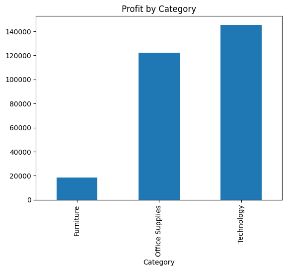
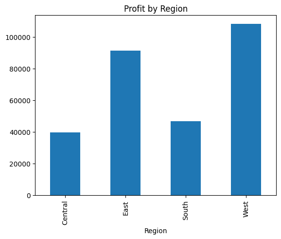
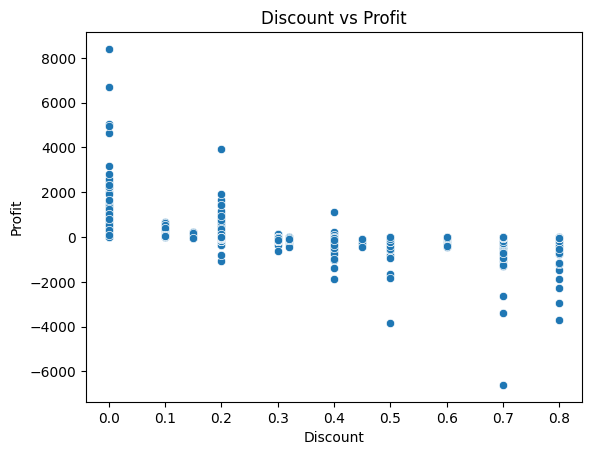
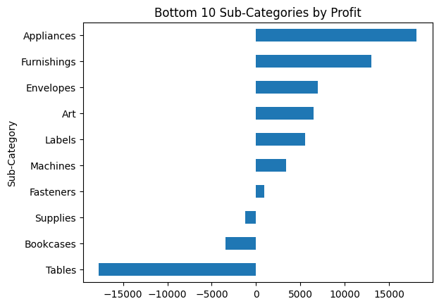

# Superstore Sales Analysis

Analysis of retail sales data to find which categories, regions, and discount levels drive or hurt profit.

## Problem
Which parts of the business make money, which lose money, and what role do discounts play?

## Dataset
Sample Superstore Dataset (Kaggle, by Aman Sharma): 9,994 orders, 13 columns (Ship Mode, Segment, Region, State, Category, Sub-Category, Sales, Quantity, Discount, Profit).

## Tools
Python (pandas, Matplotlib, Seaborn), SQL (SQLite), Google Colab

## Method
1. **Cleaning:** checked data types and missing values (none found), removed 17 duplicate rows (9,994 to 9,977), added a Profit Margin % column.
2. **SQL analysis:** aggregation (GROUP BY), CASE statements for discount bands, and a window function (RANK) to rank Sub-Categories within each Category. Queries are in `superstore_queries.sql`.
3. **Visualization:** 4 charts (profit by Category, profit by Region, Discount vs Profit, bottom 10 Sub-Categories).

## Key Findings
1. **Furniture is the weak spot.** It generates about 32% of sales but only about 6% of profit (2.5% margin vs about 17% for Technology and Office Supplies).
2. **Tables and Bookcases cause it.** Tables lost about $17.7K and Bookcases about $3.5K, roughly $21K combined. Chairs and Furnishings are profitable.
3. **Heavy discounts lose money.** Orders with no discount averaged +$67 profit; orders discounted 21-40% averaged -$78 and 40%+ averaged -$107.
4. **Central region discounts the most.** Average discount of 24% and the lowest margin (7.9%), vs West at 11% and 14.9%. Discounting appears to be a major driver of weak regional profit.
5. **Discounts alone don't explain everything.** Binders have the highest average discount (37%) yet stay profitable (+$30K), so limits should differ by Sub-Category.
6. **Copiers are the top earner** (about $55.6K profit, roughly 19% of total).

## Recommendations
- Review discounts on Tables and Bookcases first.
- Set discount limits per Sub-Category rather than one blanket cap, with a focus on the Central region.
- Keep orders at or below 20% discount where possible, since that range stayed profitable on average.

## Charts
Add your 4 chart screenshots to an `images/` folder and keep the lines below.

## Files
- `superstore_analysis.ipynb`: full notebook with code and outputs
- `superstore_queries.sql`: SQL queries used
- `SampleSuperstore.csv`: dataset

## Limitations
The dataset has no order dates, so no time-trend analysis was possible. Results show associations, not proven causes.
